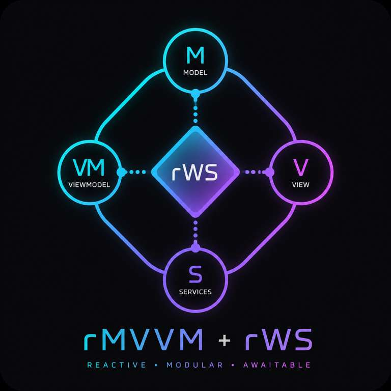

# rMVVM



> A lightweight **Reactive MVVM** architecture for Unity, paired with **rWS (Reactive Window System)** for awaitable, DI-driven UI navigation.

## Features

- ⚡ Reactive UI with R3
- 🧩 VContainer dependency injection
- 🪟 Awaitable window routing (rWS)
- 🧠 Clean MVVM architecture
- 🧪 Testable, framework-agnostic ViewModels
- 🚀 Minimal boilerplate

## Documentation

Start here based on what you need to understand:

* **[rMVVM.md](Documentation~/rMVVM.md)** — Core architecture: the Model/ViewModel/Composer/View layers, DI patterns, and UI assembly strategies. Start here if you're new to the framework.
* **[ReactiveWindowSystem.md](Documentation~/ReactiveWindowSystem.md)** — UI navigation routing: how windows are opened, stacked, and composed. The reactive window stack and its consumer patterns (e.g., InputConfig). For detailed case studies like input arbitration that depends on observable window state.
* **[DataFlow.md](Documentation~/DataFlow.md)** — Data initialization and persistence: how game state enters the app (ScriptableObjects + loaded saves), flows reactively at runtime, and is saved back to disk via DTOs.

All three are interconnected via cross-references and share a consistent vocabulary. Pick one based on your immediate question, and follow the links for deeper context.

## Installation

Install via Unity Package Manager using a Git URL:

`Window > Package Manager > + > Install package from git URL...`

```
https://github.com/cholushkin/rmvvm.git
```

### Required manual dependencies

RMVVM's Runtime assembly references 4 external assemblies (3 by GUID, 1 by name). Based on the `using` statements in the source, these resolve to:

| Package | Source |
|---|---|
| [UniTask](https://github.com/Cysharp/UniTask) | Git: `https://github.com/Cysharp/UniTask.git?path=src/UniTask/Assets/Plugins/UniTask` |
| [LitMotion](https://github.com/annulusgames/LitMotion) | Git: `https://github.com/annulusgames/LitMotion.git?path=src/LitMotion/Assets/LitMotion` |
| [R3](https://github.com/Cysharp/R3) | Git: `https://github.com/Cysharp/R3.git?path=src/R3.Unity/Assets/R3.Unity` |
| [VContainer](https://github.com/hadashiA/VContainer) | Git: `https://github.com/hadashiA/VContainer.git?path=VContainer/Assets/VContainer` |

TextMeshPro / `UnityEngine.UI` are used but not found as explicit `.asmdef` GUID references — they are likely resolved via Unity's built-in TMP Essentials rather than a package reference; no action needed if TMP Essentials are imported in the consuming project.

No dependency on other `com.qcat.*` packages was found in RMVVM's source.

Install order: the git-only dependencies above (any order), then RMVVM.
